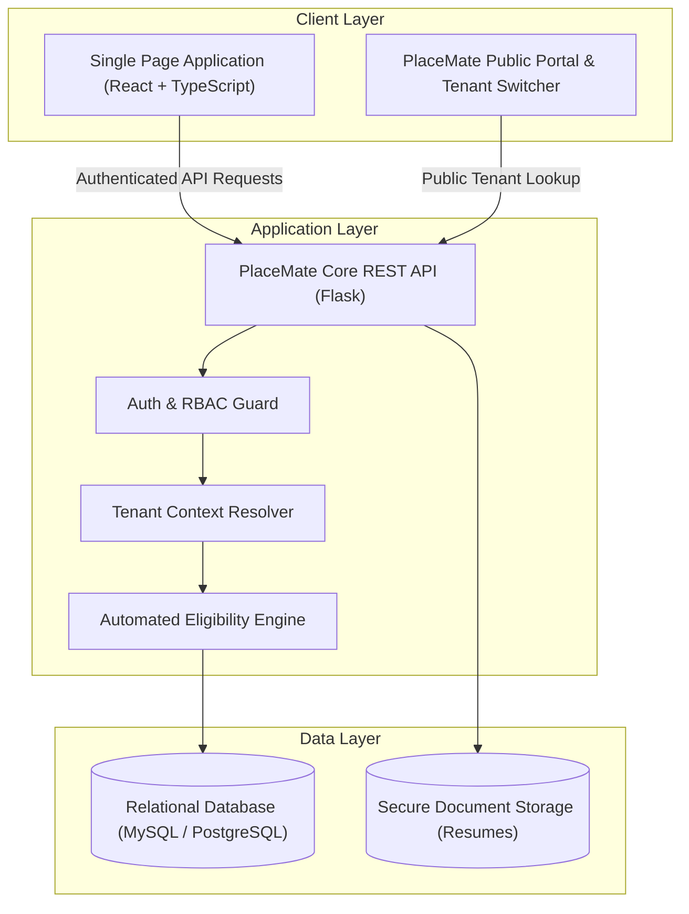

# PlaceMate

> Next-Generation Multi-Tenant Training and Placement Management Platform

PlaceMate is a modern, unified Software-as-a-Service (SaaS) platform engineered to streamline campus recruitment for educational institutions, corporate recruiters, and students. By automating eligibility verification, applicant tracking, interview scheduling, and placement analytics, PlaceMate replaces fragmented spreadsheets and manual workflows with a single, collaborative system.

---

## Architecture & Tenancy Model

PlaceMate is designed as a **Multi-Tenant SaaS solution**:
- **Institutions as Tenants**: Each subscribing university or college operates in an isolated tenant context with dedicated configurations (departments, grading metrics, eligibility policies, and branding).
- **Flagship Implementation**: Pre-configured with the South Asian University (SAU) institutional profile as the flagship deployment showcase.
- **Enterprise Security**: Role-based access control (RBAC), cryptographically salted password hashing (`scrypt`), HttpOnly session cookies, CSRF protection, and ownership-scoped queries preventing cross-tenant and horizontal data access (IDOR protection).



---

## Core Capabilities

### 🎓 Students
- **Centralized Profile**: Manage academic records, graduation year, degree major, skill inventory, and verified PDF resumes.
- **Intelligent Eligibility Engine**: Instantly view opportunities matching specific CGPA cutoffs, departments, and criteria with transparent reason breakdowns.
- **One-Click Applications**: Apply to active placement drives and internship openings with custom cover notes.
- **Live Pipeline Tracking**: Track application lifecycle stages from submission to interview rounds and final offer release in real-time.

### 🏢 Recruiters & Corporate Partners
- **Company Profile & Drive Management**: Publish and administer job openings with customizable eligibility parameters.
- **Candidate Pipeline Management**: Review applicant pools, inspect candidate resumes, and update application stages (Shortlisted, Technical Interview, HR Round, Offered, Rejected).
- **Communication & Feedback**: Attach candidate-visible evaluation notes and schedule interview sessions.

### 🏛️ University Placement Office (TPO)
- **Recruiter Governance**: Review, verify, and approve new recruiter onboarding requests and job listings before public release.
- **Student Cohort Management**: Comprehensive search, filtering, and CSV export capabilities across student cohorts.
- **Real-Time Analytics**: Live placement conversion rates, top hiring partners, branch-wise placement percentages, and CTC distribution graphs.

---

## Tech Stack

| Layer | Technologies |
| :--- | :--- |
| **Frontend** | React 18, TypeScript, Vite, Tailwind CSS, shadcn/ui, Lucide Icons, React Query |
| **Backend** | Python 3.10+, Flask 3 (Modular Blueprints, Application Factory), Werkzeug Security |
| **Database & ORM** | MySQL 8 / PostgreSQL, SQLAlchemy / Parameterized Connection Pooling |
| **Security & AppSec** | Salty Scrypt Hashing, Signed HttpOnly Cookies, CSRF Protection, In-Memory Rate Limiting |
| **DevOps & QA** | Pytest, Vitest, GitHub Actions CI, Docker, Multi-Stage Builds |

---

## Repository Structure

```
placemate/
├── docs/                     # Software engineering specifications & design models
│   ├── srs/                  # IEEE Std 830 Software Requirements Specifications
│   ├── architecture/         # Architectural design documents & C4 diagrams
│   ├── uml/                  # Formal UML models (Use Case, Sequence, Class, Activity)
│   ├── security/             # STRIDE threat models & OWASP Top 10 matrices
│   └── test-plan/            # IEEE Std 829 Software Test Documentation
├── backend/                  # PlaceMate Core API service
├── frontend/                 # PlaceMate Client Single Page Application
├── .github/                  # CI/CD workflows and automated verification pipelines
├── .gitignore                # Workspace and environment exclusion rules
└── README.md                 # Public project documentation
```

---

## Getting Started

### Prerequisites
- Node.js `20.x` or higher
- Python `3.10` or higher
- MySQL `8.0` or higher (or compatible MariaDB)

### Setup & Local Development
1. Clone the repository:
   ```bash
   git clone <REPO_URL> placemate
   cd placemate
   ```
2. Configure environment variables following `.env.example`.
3. Follow individual setup guides in `backend/` and `frontend/` directories.

---

## License & Contribution
PlaceMate is developed for educational and collaborative institutional use. Distributed under the MIT License.
