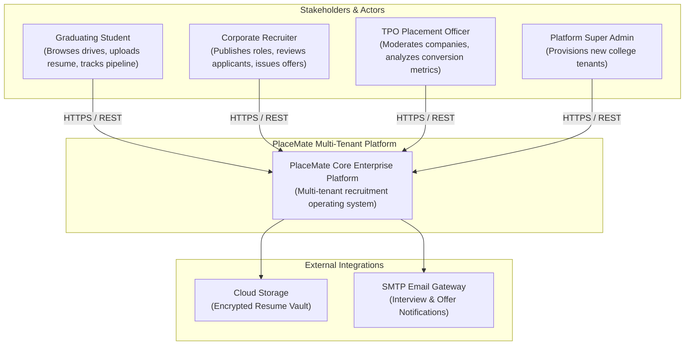
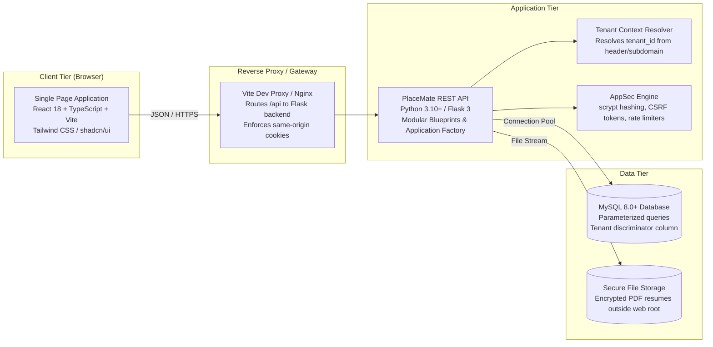

# PlaceMate: Architectural Design Document (ADD)
**Document Standard:** C4 Model & Layered Architecture Specification  
**Version:** 1.0.0 (Sprint 1 Baseline)  
**Author / Engineering Role:** Software Architect & Project Lead  

---

## 1. System Context (C4 Level 1)

PlaceMate sits at the center of institutional campus recruitment, orchestrating real-time interactions across university departments, corporate employers, and graduating students:

---

## 2. Container Architecture (C4 Level 2)

---

## 3. Multi-Tenancy Strategy: Shared Database with Tenant Discriminator

PlaceMate utilizes a **Shared Database with Column-Level Tenant Discrimination**:
- Every primary table (`users`, `students`, `companies`, `opportunities`, `applications`) includes a `tenant_id VARCHAR(64)` column.
- Middleware extracts the tenant from the `X-Tenant-ID` header (or subdomain) and binds it to Flask's request context (`g.tenant_id`).
- All queries automatically include `WHERE tenant_id = :tenant_id`, guaranteeing cross-tenant data isolation.
- South Asian University (SAU) is onboarded as `tenant_id = 'sau'` (Default launch tenant).
