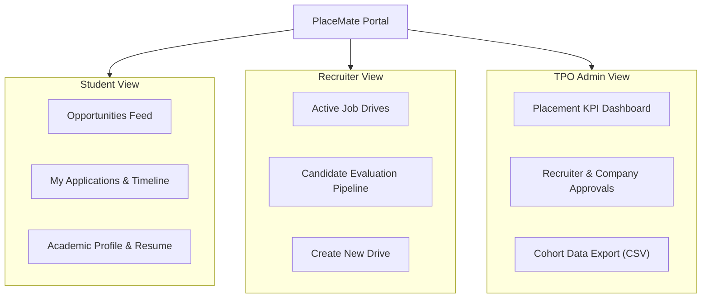

# PlaceMate: UI/UX Specifications & Component Architecture
**Document Version:** 0.1.0 (Sprint 1 Baseline)  
**Author / Role:** UX/UI Designer & Frontend Engineer  

---

## 1. Design Principles & Style Guide
PlaceMate adheres to clean, modern design standards optimized for university students and corporate recruiters:
- **Design Tokens**: Tailwind CSS utility tokens with strict spacing (4px scale).
- **Color Palette**:
  - Primary: Deep Indigo (`#4F46E5`) for primary call-to-actions.
  - Success: Emerald (`#10B981`) for eligible statuses and approved offers.
  - Warning: Amber (`#F59E0B`) for pending approvals and interview rounds.
  - Destructive: Rose (`#EF4444`) for ineligibility warnings and application rejections.
- **Typography**: Inter / sans-serif with accessible contrast ratios ($\ge 4.5:1$).

---

## 2. Information Architecture & Navigation

---

## 3. Core Component Hierarchy
1. **StatusBadge**: Displays standardized application states (`Applied`, `Shortlisted`, `Interview Scheduled`, `Offered`, `Rejected`).
2. **EligibilityBanner**: Prominent alert on job cards highlighting whether the viewing student meets the minimum CGPA and department criteria.
3. **StatCard**: Modular metric component used across TPO and Recruiter dashboards to display counts and conversion percentages.
4. **DialogWrappers**: Accessible modal dialogs for job applications, resume preview, and status updates using Radix UI primitives.
