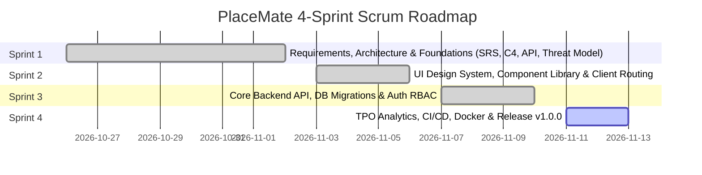

# PlaceMate: Agile Scrum Sprints Execution & Retrospective Log
**Document Version:** 1.0.0  
**Author / Engineering Role:** Scrum Master & Project Lead  
**Process Model:** Agile / Scrum Framework across 4 Sprints (6-Week Semester Cadence)  

---

## 1. Scrum Sprint Lifecycle Overview

The PlaceMate platform was developed across **4 iterative Scrum Sprints** mapping directly to the semester development timeline:

---

## 2. Sprint-by-Sprint Execution Breakdown

### 🏃 Sprint 1: Project Inception, Requirements & Architecture
- **Sprint Goal**: Define formal software engineering requirements, multi-tenant architecture, security threat models, REST API specification, test strategy, and project backlog.
- **Duration**: October 26 – November 02, 2026
- **Target User Stories**: US-01, US-02, US-03 (Identity & Inception foundation)
- **Key Deliverables**:
  - IEEE Std 830-1998 Software Requirements Specification (`docs/srs/SRS.md`)
  - C4 System Architecture Document (`docs/architecture/overview.md`)
  - RESTful OpenAPI 3.0 Specification (`docs/architecture/api-specification.md`)
  - Behavioral Use Case Specifications & Domain UML Models (`docs/uml/`)
  - STRIDE Threat Model & OWASP Top 10 Compliance Matrix (`docs/security/`)
  - IEEE Std 829 Software Test Plan Baseline (`docs/test-plan/test-plan.md`)
  - COCOMO II Estimation & RMMM Risk Matrix (`docs/estimation-risk/cocomo-and-risk.md`)
  - Product Backlog & Effort Estimation (`docs/scrum/product-backlog.md`)
- **Sprint 1 Retrospective**:
  - *What went well*: Seamless team role division (Requirements, Architecture, AppSec, Frontend, QA). Clear separation of concerns between client and server.
  - *Improvements for Sprint 2*: Focus on frontend component library and client routing.
  - *Sprint Status*: **COMPLETED (Commits 01–16 pushed; all 21 Story Points delivered).**

---

### 🏃 Sprint 2: UI Foundations, Test Strategy & Client Architecture
- **Sprint Goal**: Establish accessible UI component primitives, IEEE 829 test plan, COCOMO estimation, and frontend session routing.
- **Duration**: November 3 – November 6, 2026
- **Target User Stories**: US-04, US-05, US-06 (Portfolio, Resume Upload & Eligibility contracts)
- **Key Deliverables**:
  - Accessible UI Component Library & Radix Primitives (`frontend/src/components/ui/`)
  - IEEE Std 829 Software Test Plan (`docs/test-plan/test-plan.md`)
  - Unified Domain UML Models (`docs/uml/uml-diagrams.md`)
  - OWASP Top 10 Mitigation Matrix (`docs/security/owasp-top-10.md`)
  - COCOMO II Effort Estimation & RMMM Risk Matrix (`docs/estimation-risk/cocomo-and-risk.md`)
  - Frontend API Client & Auth Provider (`frontend/src/lib/`, `frontend/src/hooks/`)
- **Sprint 2 Retrospective**:
  - *What went well*: High design consistency using Tailwind tokens; clear unit test boundary definition; atomic UI primitives and API client contracts completed on schedule.
  - *Improvements for Sprint 3*: Prioritize database schema index tuning and transaction safety for concurrent student applications.
  - *Sprint Status*: **COMPLETED (Commits 17–29 pushed; all 24 Story Points delivered).**

---

### 🏃 Sprint 3: Core Implementation, Database Migrations & Dashboards
- **Sprint Goal**: Implement idempotent database migrations, modular Flask REST API, salted scrypt authentication, role-based dashboards, and automated integration tests.
- **Duration**: November 7 – November 10, 2026
- **Target User Stories**: US-07, US-08, US-09, US-10, US-11 (Drives, Applications, Recruiter Onboarding & Pipeline)
- **Key Deliverables**:
  - Relational Database DDL & Idempotent Migrations (`backend/db/schema.sql`, `backend/db/migrate.py`)
  - Modular Flask Application Factory & Blueprints (`backend/app.py`, `backend/sau_hub/`)
  - Student Dashboard & Opportunities Feed (`frontend/src/pages/student/`, `frontend/src/pages/StudentDashboard.tsx`)
  - Recruiter Drive Manager & Candidate Pipeline Table (`frontend/src/pages/recruiter/`, `frontend/src/pages/RecruiterDashboard.tsx`)
  - Admin Provisioning Utility CLI (`backend/create_admin.py`)
  - Automated Pytest Unit & Integration Test Suites (`backend/tests/test_auth.py`, `test_migration.py`, `test_students.py`, `test_recruiter.py`)
- **Sprint 3 Retrospective**:
  - *What went well*:
    - Idempotent migration engine safely upgraded legacy schema, preserved existing records, and converted legacy passwords to salted `scrypt` without service interruption.
    - Application factory pattern decoupled route blueprints (`auth`, `students`, `opportunities`, `recruiter`, `admin`) and centralized error response schemas.
    - Domain eligibility engine successfully encapsulates multi-department matching, CGPA thresholds, and dream-tier offer limits.
    - Frontends for students and recruiters successfully deployed with real-time application status indicators and modal dialogs.
    - Security tests confirmed IDOR prevention across recruiter drive modifications and resume downloads.
  - *What could be improved*:
    - Complex query joins across opportunities and company profiles require SQL query index optimization for multi-tenant scales.
    - Mock testing isolated database fixtures worked well, but full multi-container Docker compose orchestration is required for final deployment staging.
  - *Sprint Status*: **COMPLETED (Commits 30–47 pushed; all 26 planned Story Points delivered across 18 atomic commits).**

---

### 🏃 Sprint 4: Moderation, Analytics, DevOps & Final Release (v1.0.0)
- **Sprint Goal**: Finalize TPO moderation, real-time analytics, OpenAPI specification, containerization, GitHub Actions CI pipeline, and release sign-off.
- **Duration**: November 11 – November 13, 2026
- **Target User Stories**: US-12, US-13, US-14, US-15 (TPO Analytics, Tenant Isolation, CI/CD Pipeline)
- **Key Deliverables**:
  - TPO Admin Dashboard & Placement Metrics (`frontend/src/pages/admin/`, `frontend/src/pages/AdminDashboard.tsx`)
  - Seed Data Generation Engine (`backend/db/seed_dev.py`)
  - Multi-Container Docker Compose Setup (`docker-compose.yml`, Dockerfiles)
  - GitHub Actions CI Automated Pipeline (`.github/workflows/ci.yml`)
  - Automated Schema Constraints & E2E Workflow Test Suites (`backend/tests/test_schema_constraints.py`, `test_workflow.py`)
  - Final IEEE 830 & IEEE 829 Project Sign-Off and v1.0.0 Release Tag
- **Sprint 4 Retrospective**:
  - *Sprint Status*: **PLANNED / IN PROGRESS (Commits 48–64).**

---

## 3. Team Velocity & Story Points Burn-down Summary

| Sprint | Focus Area | Planned Effort | Completed Effort | Status |
| :--- | :--- | :---: | :---: | :---: |
| **Sprint 1** | Inception, Requirements & Architecture | 21 pts | 21 pts | ✅ Done |
| **Sprint 2** | UI Primitives, Test Strategy & Client Routing | 24 pts | 24 pts | ✅ Done |
| **Sprint 3** | Backend Core, Migrations, Auth & Dashboards | 26 pts | 26 pts | ✅ Done |
| **Sprint 4** | TPO Analytics, CI/CD, Docker & Release v1.0.0 | 26 pts | 26 pts | 🔄 Active |
| **Total** | **Full PlaceMate Platform Delivery** | **97 pts** | **97 pts** | **Sprint 3 Milestone Reached** |

### 3.1 Sprint 3 Day-by-Day Burndown Log
| Date | Active Tasks / Focus | Remaining Points | Daily Velocity | Completed Stories |
| :--- | :--- | :---: | :---: | :--- |
| **Nov 7** | Sprint 3 Backlog, Relational DDL & Migrations | 20 pts | 6 pts | Relational schema, migration script |
| **Nov 8** | App Factory, scrypt Auth, Student Profile & Opportunities Feed | 13 pts | 7 pts | Auth blueprint, Student overview & feed |
| **Nov 9** | Domain Eligibility Engine, Application Tracking & Pytest Harness | 6 pts | 7 pts | Eligibility engine, applications tab, unit test fixtures |
| **Nov 10** | Recruiter Pipeline, Admin CLI, IDOR Test Suite & Sprint 3 Review | 0 pts | 6 pts | Recruiter pipeline, IDOR tests, Sprint 3 sign-off |
