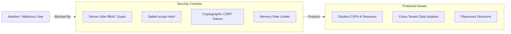

# PlaceMate: Application Security & Threat Modeling
**Document Version:** 0.1.0 (Sprint 1 Baseline)  
**Author / Role:** Backend & Application Security Engineer  
**Standard:** Microsoft STRIDE & OWASP Top 10 Framework  

---

## 1. Security Architecture Overview
PlaceMate handles sensitive student Personally Identifiable Information (PII), academic records, and corporate hiring decisions. This document outlines the initial threat landscape and mitigation controls.

---

## 2. STRIDE Threat Analysis

| Category | Threat Description | Attack Scenario | PlaceMate Mitigation Control |
| :--- | :--- | :--- | :--- |
| **Spoofing** | Attacker impersonates a student or recruiter. | Credential stuffing or token theft. | Constant-time password verification using salted `scrypt`; HttpOnly, SameSite signed session cookies. |
| **Tampering** | Student alters CGPA or application status. | Intercepting HTTP requests to mutate status from `REJECTED` to `OFFERED`. | Server-side role enforcement (`@require_role`); database state machine validates legal transition paths only. |
| **Repudiation** | Recruiter denies rejecting a candidate or making an offer. | Disputed hiring decisions. | Immutable application audit logs recording `user_id`, status change, and timestamp. |
| **Information Disclosure** | Recruiter reads candidates applied to a competing company (IDOR). | Direct Object Reference (`/api/applicants/123`). | Strict ownership validation in route handlers: applicant queries join on `company_id` matching session identity. |
| **Denial of Service** | Malicious bot spams login endpoint to lock database resources. | High-frequency automated HTTP POST requests. | In-memory IP/account rate limiting (max 5 failed attempts per 15-minute window). |
| **Elevation of Privilege** | Student calls admin endpoints to export student records. | Parameter manipulation (`role: admin`). | Session role loaded from secure server-side session, completely ignoring client-supplied role payloads. |

---

## 3. Resume Upload Security Policy
1. **File Type Verification**: Verify PDF header magic bytes (`%PDF-`) rather than trusting file extensions.
2. **File Size Cap**: Hard ceiling at 2 MB.
3. **Storage Isolation**: Uploaded files stored outside the web root using UUID v4 filenames to prevent directory traversal and arbitrary script execution.
