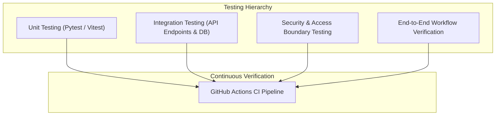

# PlaceMate: Software Test Plan (STP)
**Document Standard:** IEEE Std 829-1998  
**Document Version:** 0.1.0 (Sprint 1 Baseline)  
**Author / Role:** QA / Test Engineer & DevOps Engineer  

---

## 1. Test Plan Identifier & Introduction
- **Identifier**: `STP-PLACEMATE-V0.1.0`
- **Purpose**: Defines the testing strategy, test levels, environments, pass/fail criteria, and test execution framework for verifying the PlaceMate platform.



---

## 2. Test Items & Scope
- **In Scope for Sprint 1 / 2**:
  - Authentication & session cookie lifecycle (login, logout, session expiration).
  - Password hashing verification (`scrypt`).
  - Automated eligibility logic (CGPA boundaries, cohort validation).
  - Cross-tenant and recruiter ownership isolation (IDOR checks).
  - Application submission uniqueness constraints.
- **Out of Scope**:
  - Real-device mobile matrix testing (deferred to Sprint 4).
  - High-concurrency load and stress testing.

---

## 3. Test Cases (Initial Test Matrix)

| Test ID | Target Feature | Test Condition | Expected Result | Type |
| :--- | :--- | :--- | :--- | :--- |
| **TC-AUTH-01** | Student Login | Valid institutional email and correct password. | HTTP 200, signed session cookie set, user profile returned. | Unit / Integration |
| **TC-AUTH-02** | Student Login | Incorrect password (5 consecutive attempts). | HTTP 429 Too Many Requests, account throttled for 15 minutes. | Security |
| **TC-AUTH-03** | Password Hashing | Register new student and inspect raw database row. | Password column contains salted `scrypt` hash, zero plaintext. | Security |
| **TC-ELIG-01** | Eligibility Engine | Student CGPA 7.2 applies to drive requiring 7.5 min. | `is_eligible: false`, detailed error reason returned, Apply blocked. | Unit |
| **TC-ELIG-02** | Eligibility Engine | Student CGPA 8.0 applies to drive requiring 7.5 min. | `is_eligible: true`, Apply enabled. | Unit |
| **TC-APPL-01** | Application Duplicate | Student submits second application to same active drive. | Database rejects duplicate with HTTP 409 Conflict. | Integration |
| **TC-IDOR-01** | Recruiter Access | Recruiter A attempts `GET /api/recruiter/applicants/<id_of_company_B>`. | HTTP 404 Not Found (ownership check enforced). | Security |

---

## 4. Environmental Requirements & CI Integration
- Automated tests run against an isolated ephemeral database (`sau_hub_test` / `placemate_test`).
- Test execution configured to run on every commit via GitHub Actions:
  ```bash
  python -m pytest backend/tests/ -v
  npm test -- --run
  ```
