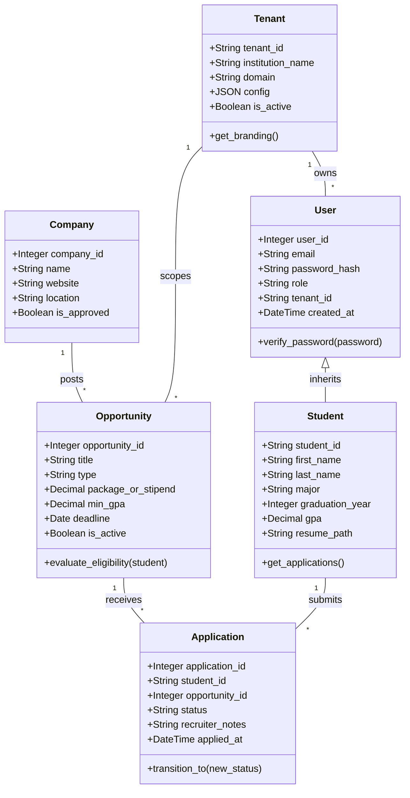
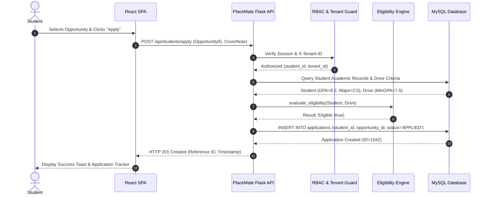
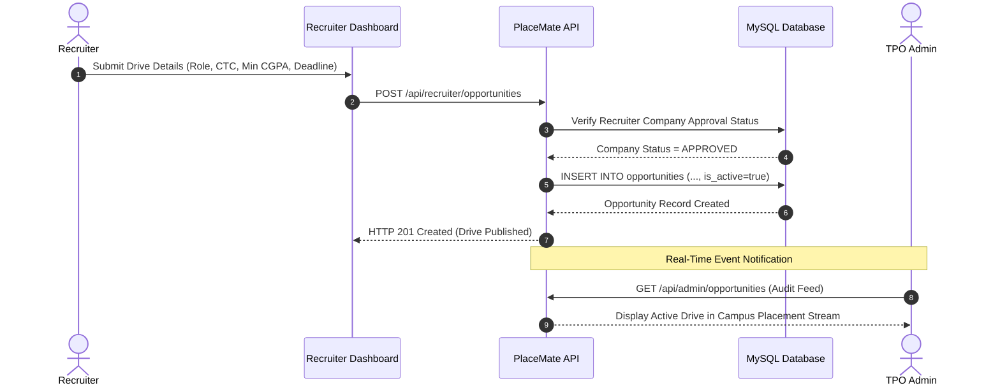
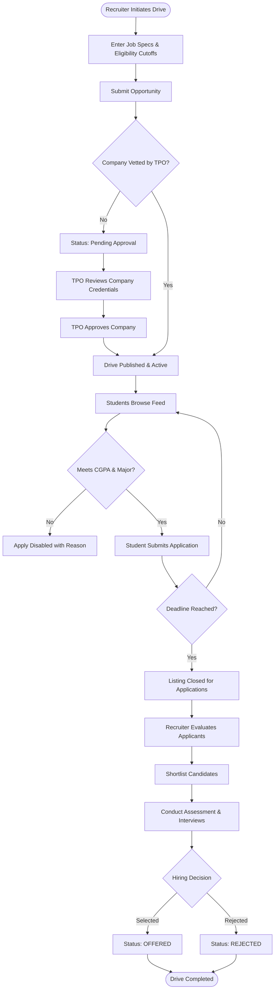
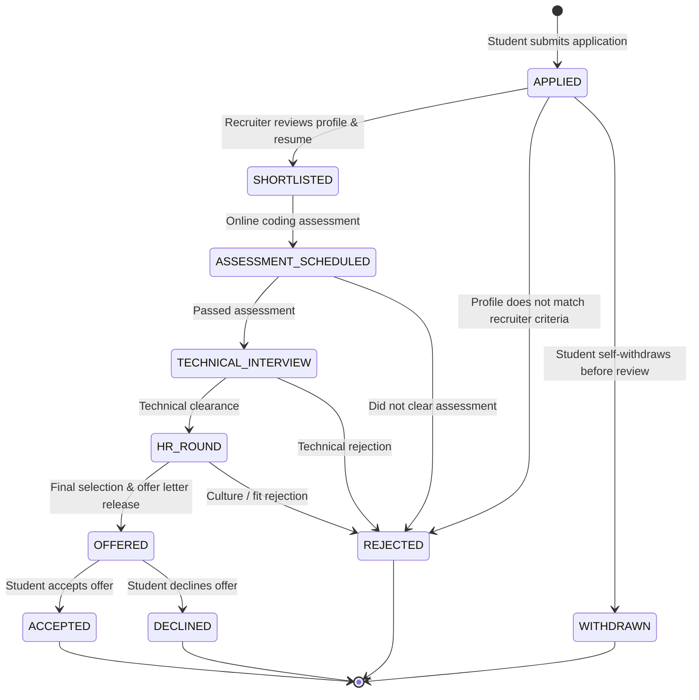
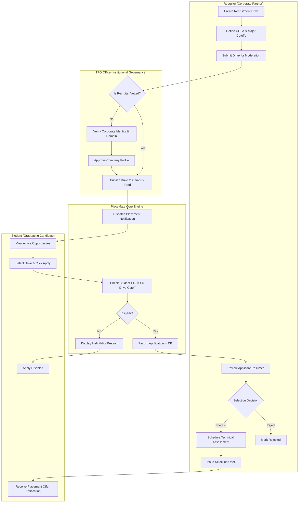

# PlaceMate: Unified UML Design Models
**Document Version:** 1.0.0 (Sprint 1 Baseline)  
**Author / Engineering Role:** Requirements Engineer & Software Architect  
**Modules Covered:** Use Case, Sequence, Class, Activity, and State Machine Modeling  

---

## 1. Domain Class Diagram (Object-Oriented Design & Patterns)

The following class diagram models the core domain entities, relationships, and design patterns (Repository Pattern, Strategy Pattern, and Factory Pattern):

---

## 2. Sequence Diagram: Student Application & Dynamic Eligibility Verification

---

## 3. Sequence Diagram: Recruiter Drive Creation & Moderation

---

## 4. Activity Diagram: Recruitment Drive Lifecycle

---

## 5. State Machine Diagram: Application Lifecycle State Transitions

### 4.1 Multi-Participant Swimlane Activity Model

