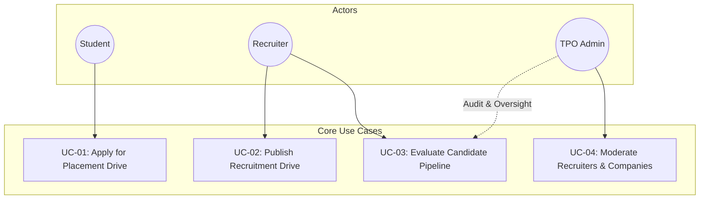

# PlaceMate: Use Case Specifications
**Document Version:** 0.1.0 (Sprint 1 Baseline)  
**Author / Role:** Requirements Engineer & System Analyst  
**Module:** Use Case Modeling & Behavioral Specifications  

---

## 1. Overview
This document specifies the core behavioral use cases for the PlaceMate SaaS recruitment workflow, mapping primary user interactions to functional requirements outlined in the SRS.

---

## 2. Detailed Use Case Specifications

### Use Case UC-01: Apply for Placement Drive
- **Primary Actor**: Student
- **Preconditions**:
  1. Student is registered and authenticated.
  2. Student has uploaded an approved PDF resume.
  3. The target opportunity is active and before deadline.
- **Main Flow**:
  1. Student navigates to the Opportunities feed.
  2. System evaluates student CGPA and graduation year against listing cutoffs.
  3. Student selects an eligible drive and clicks "Apply".
  4. System prompts for an optional cover note.
  5. Student submits application.
  6. System creates application record with status `APPLIED` and confirms with Reference ID.
- **Alternative Flow (Ineligible)**:
  - 2a. System flags student as ineligible, displays exact failed criteria (e.g., "Min CGPA 7.5 required; your CGPA is 7.1"), and disables the "Apply" button.

---

### Use Case UC-02: Publish Recruitment Drive
- **Primary Actor**: Corporate Recruiter
- **Preconditions**:
  1. Recruiter is authenticated and company account is approved by TPO.
- **Main Flow**:
  1. Recruiter selects "Create Opportunity".
  2. Recruiter inputs job title, role type (Internship/Placement), CTC/stipend, CGPA cutoff, and target cohorts.
  3. Recruiter specifies application deadline and job description.
  4. Recruiter submits the drive.
  5. System persists the listing in `PENDING_APPROVAL` or `ACTIVE` state.

---

### Use Case UC-03: Evaluate Candidate Pipeline
- **Primary Actor**: Corporate Recruiter
- **Preconditions**:
  1. Drive has received at least one student application.
- **Main Flow**:
  1. Recruiter opens the Drive Applicants dashboard.
  2. Recruiter views student profile summary and downloads PDF resume.
  3. Recruiter selects next round stage (`SHORTLISTED`, `INTERVIEW_SCHEDULED`, `OFFERED`, or `REJECTED`).
  4. Recruiter adds optional candidate-visible feedback.
  5. System records state transition with timestamp and updates student tracking view.

---

### Use Case UC-04: Moderate Recruiters & Companies
- **Primary Actor**: University TPO Administrator
- **Preconditions**:
  1. New corporate partner has registered.
- **Main Flow**:
  1. TPO opens the Recruiter Approvals panel.
  2. TPO inspects company credentials and contact email.
  3. TPO clicks "Approve".
  4. System updates recruiter status to `ACTIVE`, enabling job postings.
